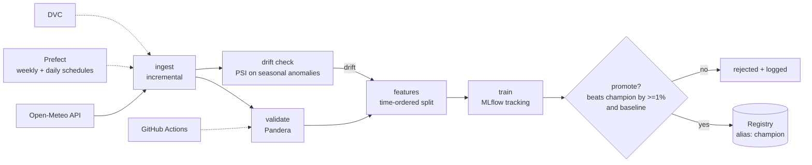
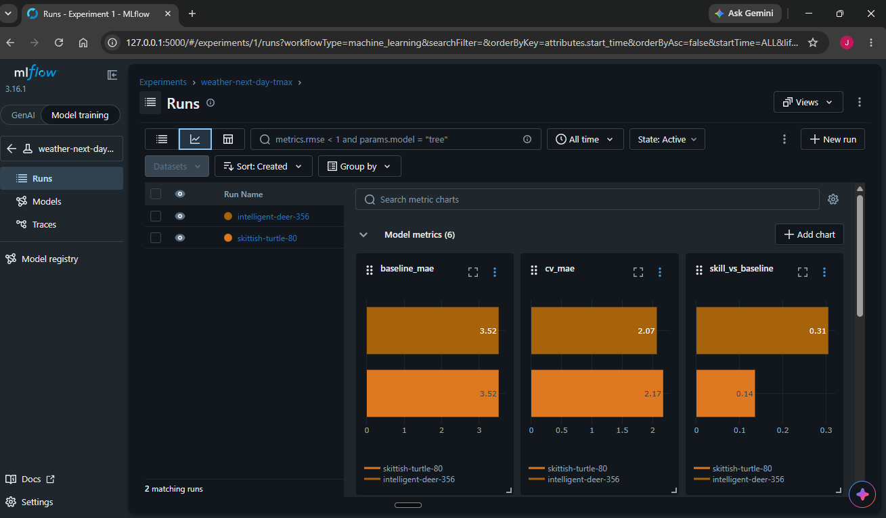
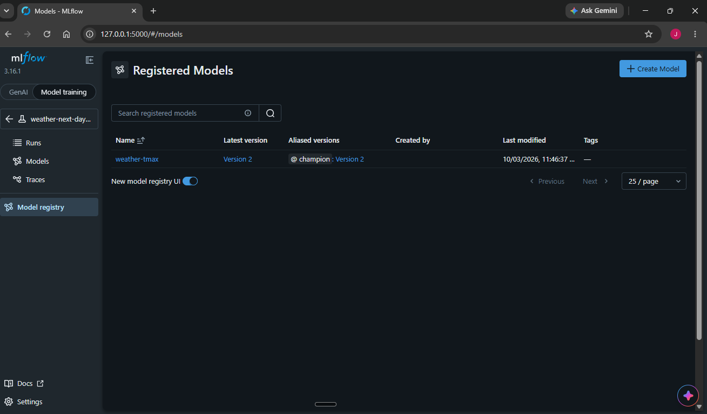

# Weather MLOps Pipeline


End-to-end ML pipeline that forecasts **next-day max temperature** from live, updating data
(Open-Meteo), with versioned data, tracked experiments, a gated model registry, orchestration,
drift-triggered retraining and CI.



## Quickstart

```bash
pip install -r requirements-dev.txt
git init && dvc init            # once
make smoke                      # full pipeline, synthetic data, no network
dvc repro                       # same pipeline, versioned by DVC, live Open-Meteo data
make ui                         # MLflow UI -> http://localhost:5000
make test lint
docker compose up --build       # MLflow + Prefect + scheduled pipeline
```

Change city, features or model in `params.yaml` (`train.model: ridge | hgb`).

## What each piece does

| Stage | File | Guarantee |
|---|---|---|
| ingest | `src/ingest.py` | Incremental; re-fetches last 7 days (values get revised) |
| validate | `src/validate.py` | Schema, ranges, no gaps, freshness. Pipeline stops on failure |
| features | `src/features.py` | Lags/rolling/seasonal; leakage test; last 180 days held out |
| train | `src/train.py` | Time-series CV, persistence baseline, params/metrics/data hash logged, version registered |
| promote | `src/evaluate_promote.py` | Champion re-scored on the *same* fresh test set; promote only if >=1% better and beats baseline |
| drift | `src/drift.py` | PSI on anomalies vs smoothed climatology, so seasons are not flagged as drift |
| orchestration | `src/flows.py` | Prefect: weekly retrain, daily drift check, retry on ingest |
| CI | `.github/workflows/ci.yml` | ruff, pytest, training smoke run, metrics in the PR summary |

## Results

Delhi (28.61N, 77.21E), daily data 2015-01-01 to 2026-09-28, last 180 days held out (time-ordered split).
Baseline = persistence ("same value as the forecast origin"). Horizon is set in `params.yaml` (`features.horizon`).

| Horizon | Model | Test MAE (C) | Baseline MAE | Improvement |
|---|---|---|---|---|
| 1 day | Ridge | 1.614 | 1.613 | none |
| 3 days | Ridge | 2.542 | 2.662 | 4.5% |
| 7 days | Ridge | 3.045 | 3.522 | 13.5% |
| 7 days | HistGradientBoosting | **2.447** | 3.522 | **30.5%** |

The 7-day gradient-boosting model is the registered `champion`. It beat the ridge champion by 19.6% on the same
test set, well past the 1% promotion threshold. Results come from a single 180-day test window,
so treat them as indicative; `cv_mae` (5-fold time-series CV) is logged in MLflow for comparison.




## What broke and how I fixed it

- **Low-variance city gave no signal.** On Mumbai (coastal, stable max temperature) 1-day ridge beat persistence by
  only 0.7% (0.648 vs 0.653), and gradient boosting was worse than the baseline (0.707). The baseline gate rejected it.
  Switched to Delhi, which has far more seasonal variation.
- **Next-day forecasting had no skill even on Delhi.** Ridge scored 1.614 vs a 1.613 baseline: yesterday's
  readings add almost nothing beyond "same as today". Added a configurable forecast horizon; at 3 and 7 days
  persistence degrades and the model's seasonal and rolling features pay off.
- **Registry compared models trained for different tasks.** Changing the horizon left a 3-day champion in the
  registry, so the 7-day candidate was scored against it on a different target. Reset the registry when the task changes.
- **PSI drift threshold false-alarmed.** 60-day windows of autocorrelated weather make PSI noisy: 0.25 fired on
  stationary synthetic data. Calibrated against simulated noise and injected drift, raised to 1.0.
- **MLflow 3 refused to load the sklearn model** (untrusted type in the skops audit). Trusted only the specific
  type this pipeline trains instead of disabling the check.

## Known limits
- Single 180-day test window; no seasonal backtest yet.
- Drift thresholds were calibrated on synthetic data and need re-tuning on real data.
- Forecasts use only past observations at one location; real forecasting uses physics-based models.
